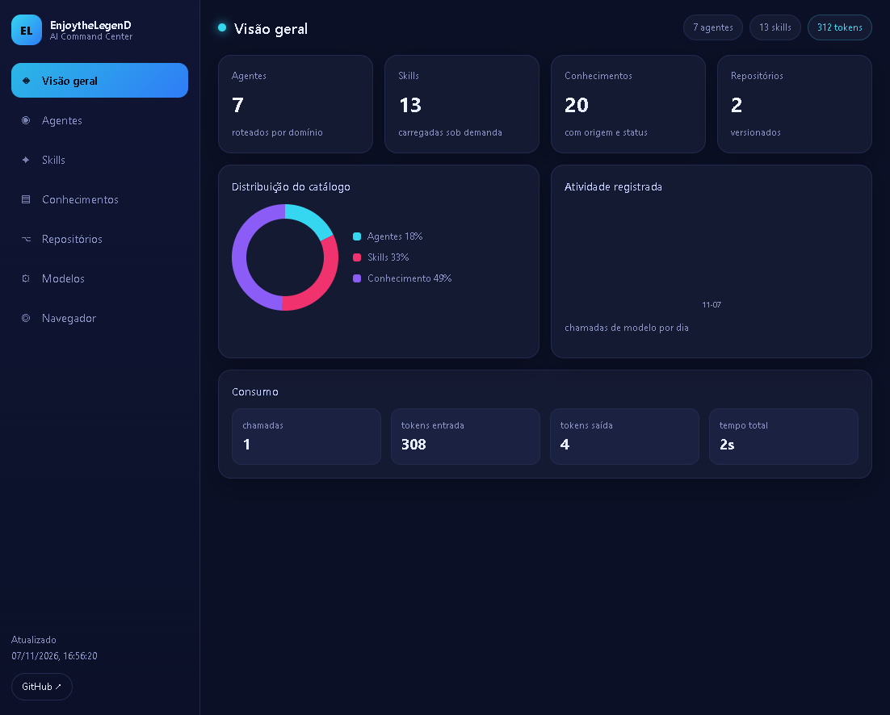

<div align="center">

# EnjoytheLegenD · AI Command Center

**Central pessoal de agentes, skills, conhecimento e repositórios.**

[](https://enjoythelegend.github.io/)
[](https://github.com/EnjoytheLegenD?tab=repositories)
[](https://opencode.ai/go)

<a href="https://enjoythelegend.github.io/">
  
</a>

</div>

---

## O que é

Painel estático que consolida o estado da minha operação de IA: agentes, skills,
biblioteca de conhecimento, repositórios, modelos e consumo de tokens.

| Link | O quê |
|---|---|
| **[Painel](https://enjoythelegend.github.io/)** | interface completa |
| [opencode-brain](https://github.com/EnjoytheLegenD/opencode-brain) | conhecimento, skills e agentes (privado) |
| [ai-command-center](https://github.com/EnjoytheLegenD/ai-command-center) | central local e especificação (privado) |

## Como funciona

```
cérebro local ──build──► data/manifest.json ──Pages──► painel
```

Abrir o painel consome **zero tokens**: ele lê um JSON gerado.
Nenhuma credencial existe aqui — o repositório é público e recebe apenas dados
agregados (nomes, descrições, contagens, status).

## Áreas

| Área | Mostra |
|---|---|
| Visão geral | KPIs, distribuição do catálogo, atividade e consumo |
| Agentes | papel, modo e modelo de cada agente |
| Skills | habilidades disponíveis e status |
| Conhecimentos | biblioteca com domínio e origem |
| Repositórios | projetos versionados |
| Modelos | catálogo do OpenCode Go |
| Navegador | barra de endereço e atalhos |

## Painel no dashboard

`userscript/dashboard-panel.user.js` injeta um cartão compacto em
`github.com/dashboard` com as contagens e atalhos. Instale com Tampermonkey.

## Atualizar

```powershell
node build-manifest.mjs
git add -A; git commit -m "manifest"; git push
```

O Pages republica sozinho em ~30 s.

## Limites declarados

- O painel **não** hospeda o motor de IA; ele abre o OpenCode local.
- Sem login, sem dado privado, sem tempo real.
- Números refletem a última geração do manifesto.
